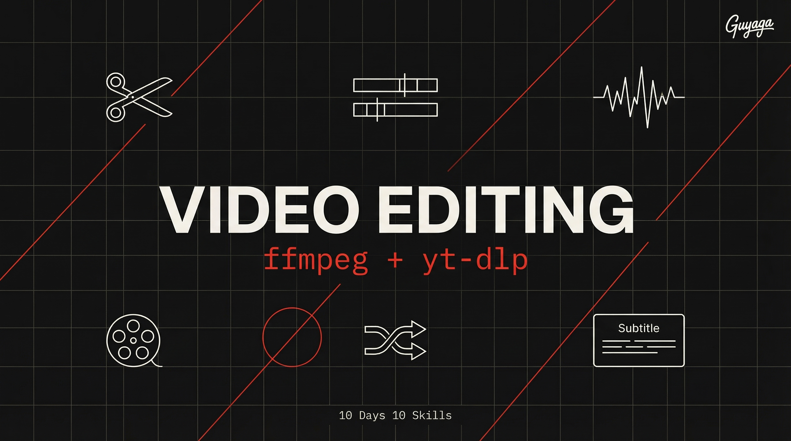

<p align="center">
  
</p>

<h1 align="center">Day 3 — AI Video Editor</h1>
<p align="center">
  <strong>10 Days 10 Skills</strong> · Claude Code Course by <a href="https://bestguy.ai">Guy Aga</a>
</p>
<p align="center">
  
  
  
</p>

---

## What is This?

This skill turns Claude Code into a **professional video editor**. Just describe what you want in plain language — Claude uses ffmpeg and yt-dlp behind the scenes to make it happen.

No video editing software needed. No timeline. No learning curve.

### What Can You Do With It?

| You Say | Claude Does |
|---------|-------------|
| "Trim my video from 0:30 to 1:45" | Cuts exactly at those timestamps |
| "Remove all the silences from my podcast" | Detects and removes dead air automatically |
| "Make a 15-second reel from this long video" | Finds best moment, crops to 9:16, trims |
| "Add subtitles to my video" | Transcribes (Day 2) → generates SRT → burns in |
| "Download this YouTube video as MP3" | Downloads and extracts audio |
| "Merge all clips in this folder into one video" | Concatenates with transitions |
| "Make this video 2x speed" | Speed up with pitch-corrected audio |
| "Extract a thumbnail at 0:05" | Saves a JPG frame |
| "Convert to GIF" | Creates optimized, high-quality GIF |

### Why This Skill?

| Feature | What It Means |
|---------|---------------|
| **No software needed** | ffmpeg runs in terminal — no Premiere, no DaVinci |
| **Works with Day 2** | Analyze video first, then edit based on insights |
| **YouTube downloads** | Grab any public video or just the audio |
| **Batch processing** | Edit 100 files at once with a single command |
| **Social media presets** | One command for Reels, Shorts, Posts, LinkedIn |
| **Free & open source** | ffmpeg and yt-dlp are completely free |

---

## Prerequisites

- [ ] **Claude Code** (Pro or Max subscription)
- [ ] **ffmpeg** installed ([download](https://ffmpeg.org/download.html))
- [ ] **yt-dlp** installed (for YouTube features)

> **No API key needed!** Unlike Days 1 and 2, this skill uses local tools — no cloud service, no tokens, no cost.

### Check if Already Installed

```bash
ffmpeg -version
yt-dlp --version
```

### Install if Missing

**Windows:**
```bash
winget install FFmpeg
pip install yt-dlp
```

**macOS:**
```bash
brew install ffmpeg yt-dlp
```

**Linux:**
```bash
sudo apt install ffmpeg
pip install yt-dlp
```

---

## Step 1: Install the Skill

### The Easy Way (Recommended)

Open Claude Code and paste:

```
Install the ai-video-editor skill from https://github.com/guyaga/10d10s-day03-video-editor and verify that ffmpeg and yt-dlp are available on my system
```

### Manual Way

```bash
cd ~/.claude/skills/
git clone https://github.com/guyaga/10d10s-day03-video-editor ai-video-editor
```

---

## How to Use It

Just tell Claude Code what you want in plain language:

### Basic Editing

```
Trim my video at D:/Videos/interview.mp4 — keep only from 2:30 to 8:15
```

```
Remove all silences longer than 1 second from D:/Videos/podcast.mp4
```

```
Speed up D:/Videos/timelapse-raw.mp4 to 4x speed
```

### Create Shorts / Reels

```
Take D:/Videos/webinar-full.mp4 and create a 30-second vertical reel 
from the most interesting part (around 15:00-20:00). 
Add subtitles and crop for Instagram.
```

### YouTube Operations

```
Download this YouTube video as MP3: https://youtube.com/watch?v=xxxxx
```

```
Download only the segment from 1:30 to 3:00 of this YouTube video: [URL]
```

### Subtitles (using Day 2 skill)

```
Transcribe D:/Videos/talk.mp4 and burn the subtitles into the video 
with big white text and black outline, social media style
```

### Batch Processing

```
I have a folder D:/Clips/ with 20 video files. 
Resize all of them to 1080x1920 (vertical) and save to D:/Clips/vertical/
```

```
Merge all MP4 files in D:/Project/scenes/ into one video with 1-second fade transitions
```

### Extract Audio

```
Extract the audio from D:/Videos/interview.mp4 and save as MP3
```

### Podcast Auto-Edit

```
Auto-edit my podcast at D:/Podcast/episode12.mp4:
- Remove all silences longer than 1.5 seconds
- Normalize the audio levels
- Export as both MP4 (video) and MP3 (audio only)
```

---

## Social Media Quick Reference

| Platform | Aspect | Size | Max Duration |
|----------|--------|------|-------------|
| Instagram Reel | 9:16 | 1080x1920 | 90 seconds |
| Instagram Post | 1:1 | 1080x1080 | 60 seconds |
| TikTok | 9:16 | 1080x1920 | 10 minutes |
| YouTube Short | 9:16 | 1080x1920 | 60 seconds |
| YouTube | 16:9 | 1920x1080 | No limit |
| LinkedIn | 16:9 | 1920x1080 | 10 minutes |

---

## Works Great With Other Skills

| Skill | How They Work Together |
|-------|----------------------|
| **Day 1: Image Generation** | Generate thumbnails, intro frames, branded overlays |
| **Day 2: Video Analyzer** | Analyze first → find best moments → then edit |
| **Day 2 → Day 3** | Transcribe → SRT → burn subtitles into video |

---

## Troubleshooting

| Problem | Solution |
|---------|----------|
| "ffmpeg not found" | Install ffmpeg and make sure it's in your PATH |
| "yt-dlp not found" | Run `pip install yt-dlp` |
| Output file is 0 bytes | Check timestamps — you might be cutting outside the video duration |
| Video has no audio after edit | You may need to add `-c:a copy` or `-c:a aac` |
| YouTube download fails | Update yt-dlp: `pip install --upgrade yt-dlp` |
| Subtitles not showing | Use `-vf subtitles=file.srt` (requires libass in ffmpeg build) |

---

## Links

- [ffmpeg Documentation](https://ffmpeg.org/documentation.html)
- [yt-dlp GitHub](https://github.com/yt-dlp/yt-dlp)
- [ffmpeg Filters Guide](https://ffmpeg.org/ffmpeg-filters.html)
- [Course Page — bestguy.ai](https://bestguy.ai/course/10-days-10-skills)
- [HTML Skill Guide (Hebrew)](https://bestguy.ai/course/guides/day03-video-editor.html)

---

<p align="center">
  <strong>10 Days 10 Skills</strong> — Claude Code Course<br>
  <a href="https://bestguy.ai">bestguy.ai</a> · Guy Aga © 2026
</p>
